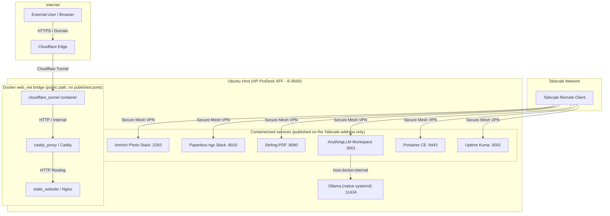

# Architecture Overview

Last verified against the running host: 2026-11-20. Placeholders: `<tailscale-ip>` is the host's Tailscale IPv4 address; `<data-uuid>` is the data partition's UUID.

## System Topology & Data Flow



Public traffic never touches a host port. Cloudflare Tunnel connects outbound to Cloudflare, and `cloudflared`, Caddy and Nginx share the `web_net` bridge network. TLS terminates at Cloudflare; Caddy serves plain HTTP on port 80 inside the Docker network (`:80 { reverse_proxy static_website:80 }`). The other services are not on `web_net`; they are reached only over Tailscale.

## Host

| Item | Value |
| :--- | :--- |
| Hardware | HP ProDesk SFF, Intel Core i5-9500, 16 GB DDR4 |
| OS | Ubuntu Linux, single boot |
| System drive | 256 GB NVMe, ext4 |
| Data drive | 500 GB HDD, single ext4 partition, label `data` |
| Patching | `unattended-upgrades` enabled for security pockets; other updates applied manually (`apt upgrade`) |

### Data drive mount

```
# /etc/fstab
UUID=<data-uuid> /home/frodo/hdd ext4 defaults,nofail 0 2
```

- `nofail` keeps the host bootable if the drive dies.
- The mount point is immutable while unmounted (`sudo chattr +i /home/frodo/hdd`, run before the first mount), so Docker cannot silently create directories on the system drive. A missing drive makes containers fail loudly instead.
- Data lives under `/home/frodo/hdd/immich` and `/home/frodo/hdd/paperless` (owned by UID/GID 1000). Immich needs `.immich` marker files in its folders; it creates them itself on first start of an empty library.
- Immich's PostgreSQL data lives in `stacks/immich/postgres` on the system drive (NVMe), not on the data drive. Back it up with a database dump, not a file copy of the running database.
- Always use absolute data paths in compose files. Desktop auto-mount paths under `/run/media/...` are RAM-backed and disappear on reboot.

## Network and exposure

| Service | Container | Published binding | Reachable from |
| :--- | :--- | :--- | :--- |
| Immich | `immich_server` | `<tailscale-ip>:2283` | tailnet |
| Paperless-ngx | `paperless-webserver` | `<tailscale-ip>:8010` | tailnet |
| Stirling-PDF | `stirling-pdf` | `<tailscale-ip>:8080` | tailnet |
| AnythingLLM | `anythingllm` | `<tailscale-ip>:3001` | tailnet |
| Portainer | `portainer` | `<tailscale-ip>:9443` | tailnet |
| Uptime Kuma | `uptime-kuma` | `<tailscale-ip>:3002` | tailnet |
| Caddy | `caddy_proxy` | none | `web_net` only |
| Nginx | `static_website` | none | `web_net` only |
| cloudflared | `cloudflare_tunnel` | none | outbound only |
| Ollama (native) | n/a | `*:11434` | firewall: tailnet and AnythingLLM subnet only |
| Remote desktop (native) | n/a | `*:3389` | firewall: `tailscale0` only |

Supporting containers (PostgreSQL, Redis/Valkey, Immich machine learning) publish no ports.

### Firewall (UFW)

Default: deny incoming, allow outgoing.

```
allow in on tailscale0
allow in on tailscale0 to any port 3389 proto tcp
allow from <anythingllm-subnet> to any port 11434 proto tcp   # AnythingLLM to Ollama
```

Docker inserts its own iptables rules for published ports and bypasses UFW, so those ports are restricted by their bind address in the compose files, not by UFW. Pin the AnythingLLM network subnet in its compose file so the Ollama rule cannot silently stop matching if the network is recreated.

### SSH

`/etc/ssh/sshd_config.d/10-hardening.conf`:

```
PasswordAuthentication no
KbdInteractiveAuthentication no
PermitRootLogin no
AllowUsers frodo
MaxAuthTries 3
```

Port 22 has no firewall rule of its own; it is reachable only through the `tailscale0` allow rule.

## Deployment

Stacks are plain Docker Compose projects deployed from this repository, with one exception. The `website-tunnel` stack (cloudflared, Caddy, Nginx) runs from a copy of its compose file inside Portainer's data directory (Compose project `2`, shown in Portainer as an externally created stack with limited control). Its tunnel token lives in the environment files next to that copy, not in git. The compose file in this repository is a reference copy; the live stack runs the same pinned images, so compare the two after any change and update both.

## Verification

Run these after any change and compare with the tables above:

```bash
docker ps --format 'table {{.Names}}\t{{.Status}}\t{{.Ports}}'
sudo ss -tlnp | grep -v '127.0.0'
sudo ufw status numbered
sudo sshd -T | grep -E '^(passwordauthentication|permitrootlogin|allowusers|maxauthtries) '
findmnt /home/frodo/hdd
curl -sI https://<public-hostname> | head -1
```

Expected: no container published on `0.0.0.0`, the data drive mounted from its own device, and the public site returning HTTP 200.

## Known gaps

See the roadmap in [README.md](README.md): backups, remaining image pinning, external uptime checks, disk encryption.
